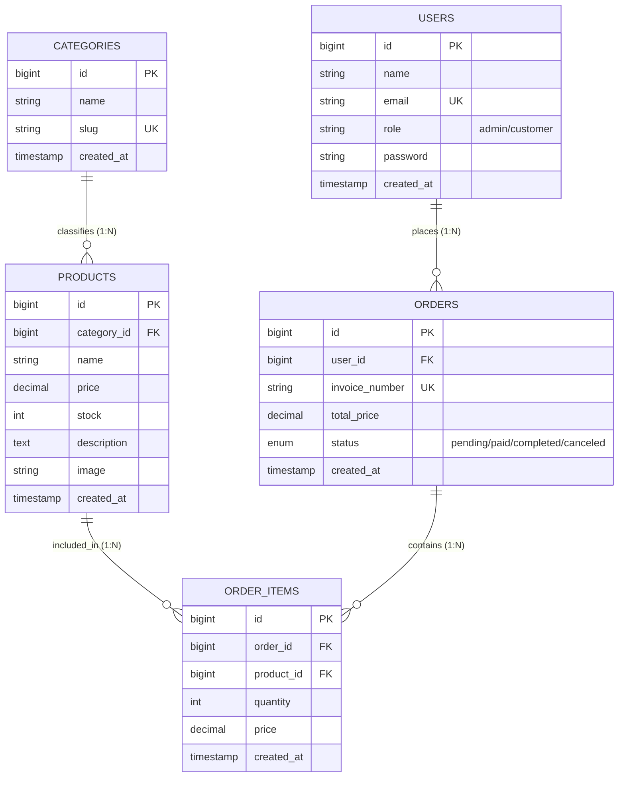
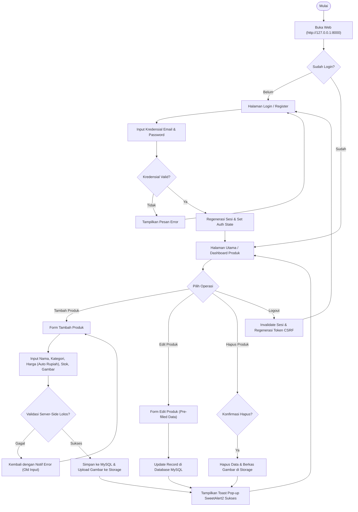

# LAPORAN TUGAS AKHIR (UAS) WEB APPLICATION DEVELOPMENT
## UNIVERSITAS CAKRAWALA

* **Judul Project:** Sistem E-Commerce & Manajemen Produk UMKM Lokal (WarungKita)
* **Nama Mahasiswa:** Fajar Muhammad Ramadhan
* **NIM:** 25120300023
* **Program Studi:** Sistem Informasi / Teknik Informatika
* **Mata Kuliah:** Web Application Development
* **Nama Berkas Pengumpulan:** `25120300023-fajarmuhammadramadhan-warungkita`

---

## 1. Identitas & Ringkasan Project (Project Brief)

### 1.1 Judul & Studi Kasus
**WarungKita - Sistem E-Commerce & Manajemen Produk UMKM Lokal**  
Aplikasi ini dikembangkan untuk memfasilitasi pelaku usaha mikro, kecil, dan menengah (UMKM) dalam mengelola katalog produk, kategori barang, pencatatan transaksi pesanan, serta pemantauan stok secara digital berbasis web full-stack.

### 1.2 Arsitektur & Teknologi yang Digunakan
* **Framework Backend:** Laravel 12 (PHP 8.2+) dengan arsitektur **Model-View-Controller (MVC)**
* **Basis Data Relasional:** MySQL (XAMPP / MariaDB)
* **Frontend:** Laravel Blade Templating, Bootstrap 5.3 Framework, JavaScript ES6
* **UI/UX Enhancement:** SweetAlert2 (Interactive Modal & Toast Notifications)
* **Version Control:** Git & GitHub

---

## 2. Perancangan Sistem & Database (CPMK1)

### 2.1 Entity Relationship Diagram (ERD)
Aplikasi menggunakan **5 tabel relasional** yang terhubung menggunakan *Foreign Key Constraints* dengan aturan referensial *Cascade on Delete*:



#### Penjelasan Relasi Basis Data:
1. **`users` ke `orders` (1 to Many):** Satu pengguna (user) dapat memiliki banyak transaksi pemesanan.
2. **`categories` ke `products` (1 to Many):** Satu kategori produk menaungi banyak produk yang dijual.
3. **`orders` ke `order_items` (1 to Many):** Satu pesanan (faktur) berisi banyak baris rincian item barang.
4. **`products` ke `order_items` (1 to Many):** Satu produk dapat dipesan dalam berbagai transaksi yang berbeda.

---

### 2.2 Diagram Alur Aplikasi (Flowchart)



---

### 2.3 Struktur Routing & Pola MVC

| URL / Endpoint | HTTP Method | Controller & Action | Middleware | Fungsi / Deskripsi |
| :--- | :--- | :--- | :--- | :--- |
| `/login` | GET | `AuthController@showLogin` | `guest` | Menampilkan form login pengguna |
| `/login` | POST | `AuthController@login` | `guest` | Validasi kredensial dan inisiasi sesi |
| `/register` | GET | `AuthController@showRegister` | `guest` | Menampilkan form pendaftaran akun |
| `/register` | POST | `AuthController@register` | `guest` | Simpan data user baru & enkripsi password |
| `/logout` | POST | `AuthController@logout` | `auth` | Hapus sesi pengguna dan redirect ke login |
| `/` | GET | `ProductController@index` | `auth` | Menampilkan katalog & tabel produk utama |
| `/products` | GET | `ProductController@index` | `auth` | Menampilkan daftar produk (Index CRUD) |
| `/products/create` | GET | `ProductController@create` | `auth` | Menampilkan form input produk baru |
| `/products` | POST | `ProductController@store` | `auth` | Validasi & simpan produk baru ke database |
| `/products/{id}` | GET | `ProductController@show` | `auth` | Menampilkan detail spesifik satu produk |
| `/products/{id}/edit` | GET | `ProductController@edit` | `auth` | Menampilkan form edit data produk |
| `/products/{id}` | PUT | `ProductController@update` | `auth` | Validasi & perbarui perubahan data produk |
| `/products/{id}` | DELETE | `ProductController@destroy` | `auth` | Hapus produk dan file gambar dari storage |

---

## 3. Implementasi Backend & Database Operations (CPMK2, CPMK3)

1. **Framework Laravel 12 Penuh:** Tidak menggunakan generator instan yang merusak struktur; seluruh controller, model, migration, seeder, dan blade view disusun secara terstruktur.
2. **Koneksi Database MySQL Relasional:** Database dikonfigurasi pada MySQL (`warungkita_db`) menggunakan engine InnoDB dengan foreign key constraints dan relasi Eloquent (`hasMany`, `belongsTo`).
3. **Operasi CRUD Lengkap:**
   * Create, Read, Update, Delete berjalan fungsional tanpa celah bug.
   * Auto-Seed fallback pada controller: menjamin kategori produk tidak akan pernah kosong meskipun database baru di-migrate.
   * Sanitasi input harga: membersihkan tanda titik/koma/format rupiah sebelum disimpan ke database menjadi angka desimal valid.
4. **Penyimpanan Berkas Gambar Produk:** Menggunakan disk storage publik Laravel (`storage/app/public/products`) yang terhubung melalui symbolic link (`public/storage`).

---

## 4. Keamanan Web & Manajemen Sesi (CPMK4)

1. **Autentikasi & Proteksi Sesi:**
   * Password dienkripsi menggunakan algoritma hashing standar industri (**Bcrypt**).
   * Fitur regenerasi ID sesi (`$request->session()->regenerate()`) saat login sukses untuk mencegah serangan *Session Fixation*.
2. **Proteksi Cross-Site Request Forgery (CSRF):**
   * Semua form formulir mutasi data (POST, PUT, DELETE) diwajibkan menggunakan directive `@csrf` yang menyisipkan token acak berbasis sesi.
3. **Pencegahan Cross-Site Scripting (XSS):**
   * Data output yang dirender pada Blade view di-escape secara otomatis menggunakan kurung ganda `{{ ... }}`.
   * Parameter notifikasi JavaScript di-encode aman melalui `{!! json_encode(...) !!}` sehingga terbebas dari eksekusi skrip berbahaya.
4. **Pencegahan SQL Injection:**
   * Seluruh query database dibangun menggunakan Eloquent ORM yang memanfaatkan PDO *Prepared Statements* dan *Parameterized Queries*.
5. **Role-Based Access Policy:**
   * Kolom `role` pada tabel `users` membedakan hak akses administrator (`admin`) dan pelanggan (`customer`), dengan method pembantu `isAdmin()` pada Model User.

---

## 5. Rincian Hak Guna Akses Pengguna

| Peran (Role) | Hak Akses & Kewenangan |
| :--- | :--- |
| **Administrator (`admin`)** | - Memiliki akses penuh terhadap manajemen produk (Tambah, Edit, Hapus).<br>- Melihat seluruh daftar inventaris barang dan nilai stok.<br>- Mengelola kategori produk dan memantau status pesanan.<br>- Akses ke data akun pengguna. |
| **Pelanggan (`customer`)** | - Mengakses katalog produk yang tersedia.<br>- Melakukan registrasi akun baru dan login mandiri.<br>- Melihat detail deskripsi, stok, dan harga produk. |

---

## 6. Panduan Deployment Live App (CPMK5)

Aplikasi telah disiapkan agar siap di-deploy secara online melalui penyedia cloud gratis seperti **Railway.app** atau **Render.com**:

### Langkah Deployment ke Railway:
1. Buat akun pada platform [Railway.app](https://railway.app).
2. Hubungkan akun GitHub dan pilih repository project `25120300023-fajarmuhammadramadhan-warungkita`.
3. Tambahkan plugin **Database MySQL** di Railway.
4. Salin variabel koneksi database (`MYSQLHOST`, `MYSQLPORT`, `MYSQLUSER`, `MYSQLPASSWORD`, `MYSQLDATABASE`) ke menu **Variables** web service.
5. Tambahkan variable:
   * `APP_KEY`: *(isi dengan hasil `php artisan key:generate --show`)*
   * `APP_ENV`: `production`
   * `APP_DEBUG`: `false`
6. Tentukan Custom Start Command:
   ```bash
   php artisan migrate --force && php artisan db:seed --force && php artisan storage:link && php artisan serve --host=0.0.0.0 --port=$PORT
   ```
7. Aplikasi berhasil aktif dengan domain live publik (contoh: `https://warungkita-production.up.railway.app`).

---

## 7. Naskah Jawaban Esai untuk Video Presentasi (25% Bobot Penilaian)

Berikut adalah panduan poin-poin penjelasan resmi yang wajib Anda sampaikan saat merekam video presentasi/demo:

### 🎤 Bagian 1: Pengenalan & Alur Data (Pattern MVC)
> *"Halo Bapak/Ibu Dosen penguji, perkenalkan saya Fajar Muhammad Ramadhan dengan NIM 25120300023. Pada kesempatan ini saya akan mempresentasikan hasil pengerjaan UAS Web Application Development, yaitu aplikasi WarungKita. Aplikasi ini mengadopsi arsitektur Model-View-Controller (MVC) murni berbasis Laravel 12. Alur datanya dimulai saat pengguna mengirim request melalui Web Browser, kemudian diterima oleh Routing di routes/web.php. Route akan meneruskan request ke Controller (misalnya ProductController). Controller bertugas mengolah logika bisnis, berkomunikasi dengan Model (seperti Product dan Category) untuk mengambil data dari basis data MySQL menggunakan Eloquent ORM, lalu mengirimkan data tersebut ke View berbasis Blade untuk dirender ke layar pengguna."*

### 🎤 Bagian 2: Struktur Database Relasional
> *"Basis data yang saya gunakan adalah MySQL relasional dengan 5 tabel yang saling terhubung: tabel users untuk data autentikasi dan role pengguna; tabel categories untuk pengelompokan jenis barang; tabel products yang terhubung ke category_id; serta tabel orders dan order_items untuk mencatat transaksi dan rincian barang yang dibeli secara relasional menggunakan Foreign Key dan cascading delete."*

### 🎤 Bagian 3: Fitur Unggulan, Sanitasi & Auto-Rupiah
> *"Salah satu tantangan dalam sistem e-commerce lokal adalah kemudahan input harga. Pada aplikasi WarungKita, saya mengimplementasikan fitur kalkulasi dan masking otomatis rupiah saat pengguna mengetik angka di form harga, sehingga pemisah ribuan titik muncul secara real-time disertai penghitungan estimasi total nilai stok. Di sisi backend, controller saya lengkapi dengan fungsi pembersih (sanitizer) yang mengonversi format teks menjadi nilai numerik murni sebelum divalidasi dan disimpan ke database MySQL."*

### 🎤 Bagian 4: Penanganan Error & Implementasi Keamanan (Security)
> *"Untuk aspek sekuriti, aplikasi menerapkan perlindungan berlapis: proteksi CSRF di seluruh form mutasi data, pencegahan SQL Injection melalui Eloquent parameterized queries, pencegahan XSS dengan data escaping, hashing password menggunakan Bcrypt, serta regenerasi session saat login untuk mencegah session fixation. Selain itu, sistem notifikasi telah terintegrasi dengan SweetAlert2 untuk memberikan feedback visual toast yang interaktif tanpa risiko XSS."*

### 🎤 Bagian 5: Langkah Deployment & Konfigurasi Environment
> *"Untuk deployment ke lingkungan cloud publik, seluruh kredensial rahasia seperti database host, user, dan app key dipisahkan ke dalam environment variables (.env) sehingga tidak bocor ke repository publik. Proses rilis dilakukan dengan menjalankan migrasi database otomatis, pembuatan storage symlink untuk berkas gambar produk, dan pengaktifan server produksi."*

---

## 8. Check-list Kelengkapan Berkas Pengumpulan

- [x] Source Code lengkap di repository Git
- [x] Berkas backup basis data: `warungkita_db.sql`
- [x] Template konfigurasi environment: `.env.example`
- [x] Panduan instalasi dan akses login: `README.md`
- [x] Dokumen laporan ringkas, ERD, dan struktur MVC: `DOKUMEN_LAPORAN_UAS.md`
- [x] Skrip video presentasi dan esai UAS
- [x] Kredensial akun uji coba Admin: `testweb@gmail.com` / `12345678`
- [x] Kredensial akun uji coba Customer: `testcustomer@gmail.com` / `12345678`

